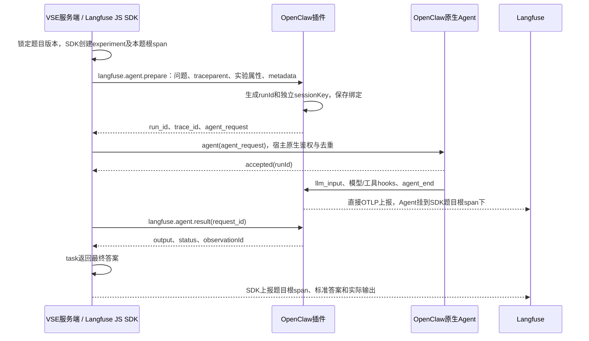

# VSE / Langfuse SDK 评测接入（0.3.0）

本功能让 OpenClaw 的 Agent、模型、工具节点接入 Langfuse SDK 已创建的每题 trace，同时传播 experiment 身份和请求级 metadata。问题集由 VSE 维护；SDK 支持 local-data experiments，不必在 Langfuse 维护第二份 Dataset。VSE 与插件各自直接向同一 Langfuse 项目上报。

**启动 experiment 不一定是先请求创建实验。SDK 建立上下文并随观测数据发送实验属性，Langfuse 据此组织实验。** 它不会自动收集期间的所有请求。每题独立 trace，所有题目共享 experiment ID。

## 启用

```bash
openclaw config set plugins.entries.openclaw-exporter-to-langfuse.config.evaluationEnabled true
# 等当前任务结束；宿主会话授权和 8 个 hook 检查同普通安装流程。
openclaw plugins reload openclaw-exporter-to-langfuse --wait
```

默认关闭。开启后新增两个 WebSocket Gateway RPC，均要求已鉴权且拥有 `operator.write`。普通 tracing 仍使用原来的 8 个 hooks，不创建新端口或接收器。Langfuse Secret Key 不随评测请求发送。

**为什么分为“登记 + 原生调用”？** OpenClaw 11.1 的 `runtime.gateway.request` 只允许内置/受信任官方插件使用。本 fork 不绕过此限制，不声明自己是官方插件；VSE 在同一连接上先登记上下文，再亲自调用原生 `agent`。这两步由 [JS task 示例](https://github.com/liuchuan01/openclaw-exporter-to-langfuse/blob/feat/openclaw-2026-11-5/examples/vse-experiment/README.md) 封装。

## 时序



## 1. 登记上下文：langfuse.agent.prepare

这是 RPC 的 `params`，不是普通聊天 API 的扩展字段：

```json
{
  "request_id": "eval_20261124_001_q003_attempt1",
  "agent_id": "main",
  "message": "根据知识库，说明产品A的赎回规则。",
  "observability": {
    "traceparent": "00-4bf92f3577b34da6a3ce929d0e0e4736-00f067aa0ba902b7-01",
    "attributes": {
      "langfuse.experiment.id": "exp_20261124_001",
      "langfuse.experiment.name": "知识库回归_20261124_001",
      "langfuse.experiment.item.id": "item_003",
      "langfuse.experiment.item.root_observation_id": "00f067aa0ba902b7",
      "langfuse.experiment.metadata.run_code": "eval_20261124_001",
      "langfuse.experiment.metadata.knowledge_version": "kb_20261123",
      "langfuse.observation.metadata.run_code": "eval_20261124_001",
      "langfuse.observation.metadata.knowledge_version": "kb_20261123",
      "langfuse.observation.metadata.vse_item_code": "2050000000000000003",
      "langfuse.observation.metadata.attempt": 1,
      "langfuse.environment": "sdk-experiment"
    }
  }
}
```

以上 ID 为示例；实际 ID 必须从 SDK 的当前 task 上下文取得，不要按示例硬编码。JS SDK 6.1.1 的公开 `getPropagatedAttributesFromContext` 可以读取它们，示例会把 SDK 的 JSON experiment metadata 转成插件接受的标量属性。

字段规则：

- request_id：每次逻辑尝试唯一；1–100 个字母、数字、下划线或连字符。同一进程内、记录保留期间，同 ID 同内容可重试；同 ID 不同内容报错。
- agent_id：默认 main；宿主中的实际 Agent ID。
- message：最多 64 Ki 字符；整个请求不超过 128 KiB。仅此字段作为问题传给模型。
- traceparent：非零 trace/span ID，W3C version 00，采样位 01。
- 必填实验属性：experiment.id、experiment.name、experiment.item.id、experiment.item.root_observation_id。
- 可选身份属性：experiment.dataset.id、experiment.item.version、environment。托管 Dataset 的 ID/version 必须来自 Langfuse；VSE 本地版本放业务 metadata。
- 业务属性仅接受 `langfuse.experiment.metadata.<key>` 和 `langfuse.observation.metadata.<key>`；key 为 1–64 个字母、数字、下划线或连字符；值为字符串（最多 4096 字符）、有限数字或布尔值。最多 64 个属性。
- 不接受标准答案、item 根节点 metadata、任意 sessionKey、原始 IO 覆盖或插件内部 runId/toolCallId 等属性。标准答案与 item metadata 由 SDK 根节点上报；需要在子节点筛选的字段显式复制为 observation.metadata。

返回示意：

```json
{
  "request_id": "eval_20261124_001_q003_attempt1",
  "run_id": "插件生成的UUID",
  "session_key": "agent:main:langfuse:插件生成的UUID",
  "trace_id": "4bf92f3577b34da6a3ce929d0e0e4736",
  "item_root_observation_id": "00f067aa0ba902b7",
  "status": "prepared",
  "agent_request": {
    "agentId": "main",
    "sessionKey": "agent:main:langfuse:插件生成的UUID",
    "message": "根据知识库，说明产品A的赎回规则。",
    "idempotencyKey": "插件生成的UUID",
    "deliver": false
  }
}
```

## 2. 发起原生 Agent

VSE 保存上面的映射后，调用原生 RPC `agent`，params 原样使用返回的 `agent_request`。不可自行改 sessionKey/idempotencyKey，否则无法保证关联。插件在首个 llm_input 中按 runId 和独立 sessionKey 领取上下文，不通过时间窗口或全局 active experiment 猜测归属。

宿主 native agent 的权限检查与去重继续生效。登记上下文不代表 Agent 已启动。若原生调用超时，不能据此判定未执行；保留原 request_id/idempotencyKey，查状态后再决定，不直接新建请求重复执行。

## 3. 查询：langfuse.agent.result

params：`{"request_id":"eval_20261124_001_q003_attempt1"}`。

返回相同的关联标识，以及 status；完成后带 `output`、`observationId`（Agent 节点 ID），失败时带 `error`。SDK task 返回 output，使实验题目的实际答案与 Agent 答案一致。

| 状态 | 含义 |
| --- | --- |
| prepared | 上下文已登记，尚未观察到该 run 的 llm_input |
| running | 已按 runId/sessionKey 绑定并开始记录 |
| completed | Agent 结束，输出可供 SDK task 返回 |
| failed | Agent 报错、宿主会话不匹配、或 tracing 运行因关闭/空闲超时结束 |
| unknown | 登记 30 分钟仍未观察到 llm_input，需调用方核查 |

completed 不代表 Langfuse 已查询可见，更不代表已评分。OTLP 是异步批量发送；VSE 执行器要 flush 自己的 SDK 数据，Langfuse 送达和评分另行验证。

## 生命周期与评分

进程内最多保存 1000 个登记项，完成/过期结果保留一小时；不淘汰正在执行的记录来接收新请求。插件重启/重载会丢失登记和结果。VSE 必须持久化请求和关联 ID；重载后查不到状态时先核查 Langfuse，不自动重发。长时间运行的任务沿用 tracing 的 20 分钟空闲清理机制。

独立题目使用独立会话；本版不提供指定已有会话的多轮评测。问题集版本、知识版本、attempt 等由 VSE 维护；插件不判断这些业务版本是否真实生效。

整题评分关联 SDK 的 root observation；Agent/每轮模型/工具评分关联各自 observationId。创建 experiment 不会自动对每个节点评分，需要配置 evaluator 或人工评分。实验与各节点均保留 experiment/item/root ID 和用于筛选的业务 metadata。

参考：[SDK experiments](https://langfuse.com/docs/evaluation/experiments/experiments-via-sdk)、[OTEL 实验属性](https://langfuse.com/integrations/native/opentelemetry/experiments)。
